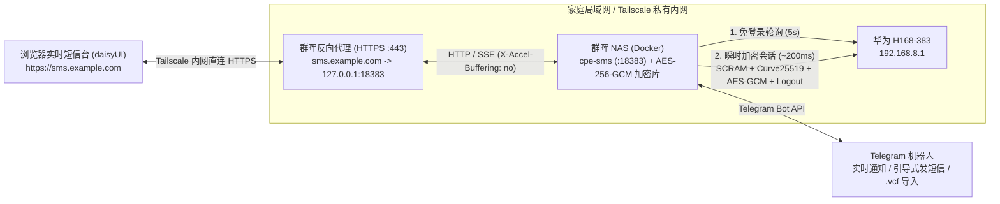

# cpe-sms — 华为 5G CPE Ultra 6 (H168-383) 短信网关 · Telegram 机器人 · daisyUI 实时网页中心

使用 **Strict TypeScript** 构建、专为 **华为 5G CPE Ultra 6 (`H168-383`)** 打造的全功能短信收发与加密归档系统。支持自动完成 CPE 管理后台鉴权与报文加解密，提供 **Telegram 双向机器人（含引导式发短信向导）**、基于 **`daisyui` v5 构建的高位端口实时网页中心（默认统一端口 `:18383`）**、**AES-256-GCM 本地全盘加密归档**、**54 国国际区号识别** 以及 **iPhone `.vcf` 通讯录本地导入**，专为局域网 NAS（群晖 DSM / Docker）与 **Tailscale + HTTPS 反向代理** 场景设计。

---

## 核心特性

- **🔐 全链路安全与本地 AES-256-GCM 静态加密（Encryption at Rest & In Transit）**
  - **本地落盘全加密**：`data/state.json`、`data/sms-archive.json`、`data/contacts.json` 全部通过 `scrypt` + 随机盐 `HKDF-SHA256` + 随机 IV **`AES-256-GCM`** 加密并设置 `0600` 权限原子落盘，杜绝明文短信、验证码或通讯录落盘泄漏。
  - **CPE 传输层加密**：完整实现 H168-383 固件的**华为 SCRAM-SHA256** 握手与 **Curve25519 ECDH（大端无钳位）+ AES-256-GCM (`enc-type=1|2|3`)** 接口加解密，并校验路由器 RSA-PSS 公钥签名。
  - **HTTPS 反向代理原生适配**：自动识别 `X-Forwarded-Proto: https` 签发 `Secure; HttpOnly; SameSite=Strict` 会话 Cookie，内置登录防爆破限流、安全响应头与 Nginx SSE 零缓冲头（`X-Accel-Buffering: no`）。
- **🌼 高位单端口 daisyUI 实时短信网页中心（默认 `:18383`，绝不占用 `:8080`）**
  - 基于官方 **`daisyui` (v5) + Tailwind CSS v4** 编译打包（零外部 CDN 依赖，内网离线秒开，内置 `Light` / `Dark` / `Nord` / `Emerald` / `Dim` / `Cupcake` 6 款主题）。
  - **单端口统一收敛**：`:18383` 同时承载实时 Web 界面、SSE 事件流（`/api/events`）、`/healthz` 健康检查与 Bearer/Cookie REST API，避免与群晖 NAS 上常用的 `8080` 容器端口冲突。
  - **全量历史短信加密归档**：自动分页拉取 CPE 内全部收发件箱短信加密保存至本地 `data/sms-archive.json`，即便清理了 CPE 500 条存储上限，本地历史对话依然永久保留。
- **✍️ Telegram 引导式发短信向导 & 原生回复发信**
  - **分步引导式发信（`/new` 或点击 `✍️ 引导式发送短信`）**：默认采用 **🇮🇪 爱尔兰区号 (`+353`)**，输入本地号（如 `083 123 4567`）自动规范化为 `+353831234567`；支持一键切换 `+86` / `+44` / `+1` / `+852`、直接输入 `+国际号码` 或按联系人姓名搜索，并在发送前预览编码与分段条数。
  - **直接「回复」通知即发短信**：长按/右键「回复 (Reply)」任意短信通知卡片即可直接回信。
- **🌍 54 国区号识别 & iPhone `.vcf` 通讯录导入**
  - 自动标注国家国旗与区号、字母品牌服务号（如 `Three`、`Apple`、`Revolut`）及正文 `【品牌签名】`；支持将 iPhone 导出的 `.vcf` 文件直接发给 Telegram 机器人或在网页上传，加密保存在本地。
- **⚡ 零冲突瞬时会话**
  - 平时每 5 秒调用免登录 `/api/monitoring/check-notifications`，仅在有新短信或收发操作时建立 ~200ms 瞬时会话并立即登出，绝不抢占浏览器访问 `http://192.168.8.1/#/sms`，遇到密码错误 (`108006`) 立即熔断防锁定。

---

## 架构概览



---

## 快速开始

### 1. 配置文件（`.env`）

```bash
cp .env.example .env
```

核心配置示例（完整说明见 [`.env.example`](.env.example)）：

```dotenv
CPE_URL=http://192.168.8.1
CPE_PASSWORD=你的CPE管理界面密码
TELEGRAM_API=你的Telegram机器人Token

# 默认电话国家区号（默认爱尔兰 +353）
DEFAULT_COUNTRY_CODE=+353

# 🌼 实时网页与统一 API 高位端口（默认仅绑定 18383，不占用 8080）
WEB_ENABLED=true
WEB_PORT=18383
```

---

### 2. 群晖 NAS / Docker Compose 部署

多阶段构建镜像（运行时零 `node_modules` 依赖，内置 `su-exec` 自动修正群晖 `./data` 挂载目录权限并以非 root `node` 用户运行）：

```bash
sudo docker compose up -d --build
```

- 局域网 / Tailscale 直连访问：`http://<NAS_IP>:18383`（登录密码默认即 `CPE_PASSWORD`）。
- 如需关闭网页仅保留后台 Telegram 机器人：在 `.env` 设置 `WEB_ENABLED=false` 后执行 `sudo docker compose up -d`。

---

### 3. 绑定 Tailscale 内网域名（Cloudflare DNS + 群晖反向代理 HTTPS）

如果你已为 NAS 配置了 Tailscale IP（如 `100.x.y.z`）与泛域名证书（如 `*.example.com`），只需两步即可通过 `https://sms.example.com` 免输端口安全访问：

1. **Cloudflare DNS 添加解析**：
   - 类型：`A`
   - 名称：`sms`
   - IPv4 地址：填写 NAS 的 **Tailscale IP**（如 `100.x.y.z`）
   - 代理状态：**仅限 DNS（灰色云朵 `DNS only`）**
2. **群晖 DSM 配置反向代理与证书**：
   - 打开 **控制面板 -> 登录门户 -> 高级 -> 反向代理服务器 -> 新增**：
     - **来源**：协议 `HTTPS`，主机名 `sms.example.com`，端口 `443`，勾选「启用 HSTS」。
     - **目的地**：协议 `HTTP`，主机名 `127.0.0.1`，端口 `18383`。
   - 打开 **控制面板 -> 安全性 -> 证书 -> 设置**，将 `sms.example.com` 对应的证书选为你的 Let's Encrypt / ACME 域名证书并确定。

---

### 4. 本地开发、编译与 TDD 质量检查（Node.js >= 22.6）

```bash
# 安装开发编译依赖（TypeScript 7 + Tailwind v4 + daisyUI v5 + c8）
npm install

# 编译前后端 TypeScript 与 daisyUI 样式至 dist/
npm run build

# 启动生产构建服务
npm start

# 运行全套检查门禁（严格 TS 类型检查 + >=90% 覆盖率测试 + Git 密钥泄漏扫描）
npm run check
```

常用 CLI 子命令：
```bash
npm run cpe:status                           # 查看 CPE 5G 信号与短信容量
npm run cpe:sync                             # 全量拉取历史短信并加密归档至 data/sms-archive.json
npm run cpe:inbox                            # 查看最近会话（含国家国旗与联系人识别）
npm run cpe:send -- 0831234567 "Hello!"      # 发送短信（默认 +353 爱尔兰本地号自动补全）
npm run cpe:import-vcf -- ./Contacts.vcf     # 导入 iPhone / Mac 导出的 .vcf 通讯录
```

---

## Telegram 机器人指令速查

首次在 Telegram 向机器人发送 `/auth 你的CPE登录密码` 即可完成绑定（含密码消息会自动撤回，绑定信息加密存入 `data/state.json`）。

| 指令 / 交互 | 功能说明 |
| :--- | :--- |
| **`/new`**（或点击 `✍️ 引导式发送短信`） | **交互式分步发短信**：默认 `🇮🇪 +353`，支持一键切换区号或搜联系人 -> 输入内容 -> 预览确认发送 |
| **直接「回复」短信卡片** | 长按/右键回复任意通知或对话消息，输入内容直接回信 |
| **直接发送 `.vcf` 文件** | 将 iPhone 导出的 `.vcf` 文件发给机器人，自动加密导入本地通讯录 |
| `/inbox` / `/unread` | 查看最近会话列表 / 未读短信与验证码提取 |
| `/chat <号码或服务号>` | 查看与某号码的历史对话详情 |
| `/send <号码> <内容>` | 一行命令快速发短信 |
| `/contact <号码> <姓名>` | 为号码添加或修改姓名备注 |
| `/contacts [关键词]` | 查看或搜索本地加密通讯录 |
| `/status` / `/sync` | 查看 5G 信号与存储容量 / 立即全量同步历史归档 |

---

## 工程规范与安全审计

项目开发严格遵循 TDD 与零密钥泄漏规范，详见 [`AGENTS.md`](AGENTS.md)。
