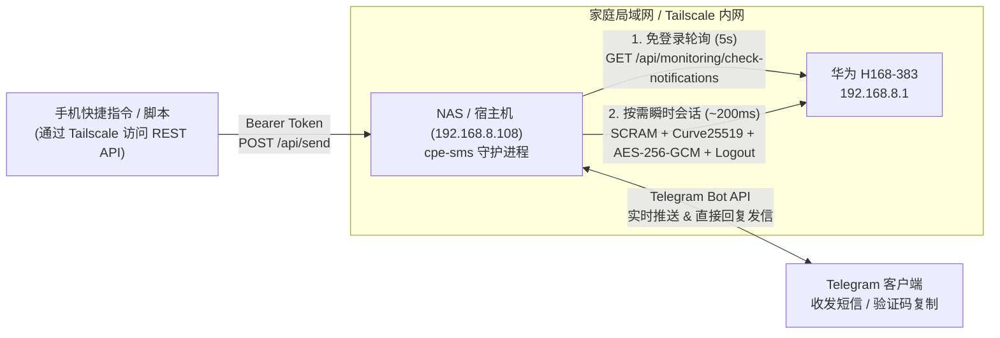

# cpe-sms — 华为 5G CPE Ultra 6 (H168-383) 短信网关 & Telegram 机器人

专为 **华为 5G CPE Ultra 6 (`H168-383`)** 打造的轻量级短信收发网关。支持自动完成 CPE 管理后台鉴权与报文加解密，通过 **Telegram Bot** 实时接收短信推送（自动提取验证码一键复制）、**直接回复消息发短信**，同时内置 **CLI 命令行**、**HTTP REST API** 与 **Webhook**，非常适合部署在局域网 NAS（如 `192.168.8.108`）或任意接入 **Tailscale** 子网路由的节点上 7×24 小时稳定运行。

---

## 核心特性

- **原生完整协议通信支持（零第三方 npm 依赖）**
  - 完整实现 H168-383 固件的**华为非标 SCRAM-SHA256** 登录挑战握手、`_ResponseSource: Broswer` 头与单次滚动 CSRF Token 队列。
  - 原生实现 `SoftwareCapability[208] = 1` 要求的 **Curve25519 ECDH（大端无钳位 Montgomery Ladder）+ AES-256-GCM (`enc-type=1|2|3`)** 请求/响应加解密与服务端公钥签名防篡改校验。
- **浏览器零冲突共存（免登录轮询 + 瞬时会话）**
  - H168-383 同一时刻仅允许 1 个管理员会话在线（传统常驻脚本会导致浏览器打开 `http://192.168.8.1/#/sms` 报 `108003` 重复登录错误）。
  - 本程序平时每 5 秒调用**免登录**接口 `/api/monitoring/check-notifications` 监控未读数，仅在检测到新短信或执行指令时发起一次约 `200ms` 的 `登录 -> 加解密读写 -> 立即登出` 原子操作，并在后台检测到你正用浏览器登录时自动避让周期同步。
- **防锁定保护**
  - 若密码配置错误（返回 `108006`），立即熔断报错**绝不自动重试**，防止触发 CPE 管理账户锁定（`108007`）。
- **丝滑的 Telegram 双向交互体验**
  - **免查 Chat ID 一键配对**：首次对机器人发送 `/auth <CPE密码>` 即可完成绑定并**自动撤回含密码的消息**，授权记录持久化保存在本地 `data/state.json`。
  - **验证码高亮复制**：自动识别中英文验证码/OTP，在通知卡片中以 `<code>123456</code>` 单击复制格式展示。
  - **原生「回复」即发短信**：在 Telegram 中直接长按/右键「回复 (Reply)」任意一条短信通知或对话卡片，输入文字即可直接通过 CPE 发送短信给对方号码，并自动轮询运营商回执状态（`send-status`）。
  - **首启防刷屏**：首次启动自动建立现有历史短信游标快照，不会把收件箱里的上百条存量旧短信一股脑刷屏推送。
- **NAS & Tailscale 友好**
  - 基于纯 Node.js 标准库（`node:crypto`、`fetch`、`node:http`），`node:22-alpine` 镜像体积小、内存占用仅 ~35MB，支持 x86_64 / ARM64 NAS 一键 `docker compose up -d`。
  - 可选开启 Bearer Token 保护的 **HTTP REST API** 与 **Webhook**，只要连入 Tailscale 网络，随时可通过手机「快捷指令」、`curl` 或其他服务收发短信。

---

## 为什么不直接用 GitHub 现有开源项目？

针对常见的华为 HiLink 开源库与工具，结合对 `H168-383` 固件前端与真机的实测对比如下：

| 项目 / 方案 | 对 H168-383 的兼容性与局限 |
| :--- | :--- |
| **`Salamek/huawei-lte-api`** (Python)<br>**`lvcdy/huawei-lte-api-go`** (Go) | 支持基础 SCRAM 登录，但**完全未实现 `SoftwareCapability[208]` 的 Curve25519 ECDH + AES-256-GCM 接口加密**。在 H168-383（`encrypt_enabled=1`）上，WebUI 的会话联系人列表（`sms-list-contact`）、单号码对话（`sms-list-phone`）、发送短信（`send-sms` `enc-type=2`）与发送状态轮询（`send-status` `enc-type=1`）均走加密通道。 |
| **`PlayFaster/ha-huawei-router-5g-monitor`** | 重度绑定 Home Assistant，底层直接依赖 `huawei-lte-api`，不含 ECC/AES-GCM 报文加密实现，且无法独立作为轻量 Telegram 双向网关运行。 |
| **`yoratoni/huawei-router-sms-forwarding`** | 通过运营商短信将收到的短信“再发一条手机短信”到另一张卡（消耗短信资费），不支持 Telegram 实时推送与交互式回复。 |
| **`chenwei791129/...SMS-to-E-mail-Sender`** | 仅支持老款路由登录与单向 SMTP 邮件转发，不支持 SCRAM/ECC 加密与双向发信。 |
| **原生 `curl` 直接 POST XML** | 无法直接工作：每次请求前必须维护 `SessionID`、提取 64 位 Token 后 32 位并追踪响应头 `__RequestVerificationTokenone/two` 滚动更新，完成非标 SCRAM 握手后还需进行 Curve25519 密钥协商与 AES-256-GCM 封装。 |

---

## 架构概览



---

## 快速开始

### 1. 配置文件（`.env`）

复制模板或确认项目根目录下的 `.env` 文件：

```bash
cp .env.example .env
```

最小必填配置只需两项（其余均有合理默认值）：

```dotenv
CPE_URL=http://192.168.8.1
CPE_PASSWORD=你的CPE管理界面密码
TELEGRAM_API=你的Telegram机器人Token
```

> **提示**：你无需手动查找并填写 `TELEGRAM_CHAT_IDS`。程序启动后，在 Telegram 中打开你的机器人，发送 `/auth 你的CPE管理界面密码`，机器人验证通过后会自动撤回该条密码消息，并将你的 Chat ID 安全持久化写入 `./data/state.json`。

---

### 2. 部署方式一：NAS (`192.168.8.108`) Docker Compose 部署（推荐）

将仓库上传或克隆到 NAS（例如 `/volume1/docker/cpe-sms`），确保同目录下有配置好的 `.env` 文件，执行：

```bash
docker compose up -d --build
docker compose logs -f
```

- 容器会自动将状态游标与授权记录保存在 `./data/state.json`。
- 如果 NAS 安装了 Tailscale 并暴露了 `192.168.8.0/24` 子网路由（或容器运行在任意已连入该 Tailscale 网络的机器上），`CPE_URL=http://192.168.8.1` 均可直接连通。
- 默认同时在 `8080` 端口提供受密码/Token 保护的 HTTP API（如不需要可在 `.env` 中设 `HTTP_PORT=0`）。

---

### 3. 部署方式二：本地 / 裸机直接运行（Node.js >= 20）

无需 `npm install`（零外部依赖），直接运行即可：

```bash
# 查看 CPE 当前连接、运营商、5G/4G 信号与短信容量
npm run cpe:status

# 查看最近短信联系人会话
npm run cpe:inbox

# 查看未读短信（自动提取验证码）
node src/cli.js unread

# 查看与指定号码/服务号的对话记录
npm run cpe:thread -- 10086

# 命令行直接发送短信
npm run cpe:send -- 10086 "CXLL"

# 启动常驻守护进程（监听新短信 + Telegram Bot + HTTP API）
npm start
```

---

## Telegram 机器人使用指南

1. 启动服务（`npm start` 或 `docker compose up -d`）。
2. 在 Telegram 搜索并打开你的机器人，首次发送：
   ```text
   /auth 你的CPE登录密码
   ```
3. 绑定成功后即可使用以下全部能力：

| 指令 / 操作 | 功能说明 |
| :--- | :--- |
| **直接「回复」通知消息** | 对着机器人推送的任意短信通知或 `/chat` 对话卡片点击**回复 (Reply)** 并输入文字，自动作为短信回复给该号码 |
| `/inbox`（或 `/sms`） | 分页浏览最近短信联系人会话，提供一键进入对话按钮 |
| `/unread` | 列出最近未读短信及提取出的验证码，支持一键全部标为已读 |
| `/chat <号码或服务号>` | 解密查看与某号码（如 `10086`、`Three`、`Apple`）的历史往来短信 |
| `/send <号码> <内容>` | 发送短信（自动识别 GSM 7-bit / UCS-2 中文编码与长短信分段，并轮询运营商发送回执） |
| `/status` | 查看 H168-383 在线状态、运营商、5G NR / 4G LTE 信号（RSRP/SINR）与收件箱容量（如 `184/500`） |
| `/read <ID 或 all>` | 将指定短信 ID 或最近未读短信设为已读 |
| `/delete <ID>` | 删除指定 ID 的短信 |
| `/sync` | 立即触发一次收件箱同步检测 |

---

## HTTP REST API（适配 Tailscale / 快捷指令 / 自动化）

当 `HTTP_PORT=8080`（默认）开启时，所有 `/api/*` 接口均需携带请求头 `Authorization: Bearer <API_TOKEN>`（若 `.env` 未单独配置 `API_TOKEN`，默认使用 `CPE_PASSWORD`）：

```bash
# 1. 健康检查（免鉴权）
curl http://192.168.8.108:8080/healthz

# 2. 查询 5G 信号与短信统计
curl -H "Authorization: Bearer $CPE_PASSWORD" \
  http://192.168.8.108:8080/api/status

# 3. 查询最近短信（?unread=1 仅看未读，或 ?phone=10086 查看单号码对话）
curl -H "Authorization: Bearer $CPE_PASSWORD" \
  "http://192.168.8.108:8080/api/messages?unread=1"

# 4. 发送短信
curl -X POST http://192.168.8.108:8080/api/send \
  -H "Authorization: Bearer $CPE_PASSWORD" \
  -H "Content-Type: application/json" \
  -d '{"phone": "10086", "content": "CXLL"}'
```

如配置了 `WEBHOOK_URL`，每次收到新短信时还会自动向该地址 `POST` 如下 JSON：

```json
{
  "event": "sms.received",
  "timestamp": "2026-10-27T23:00:00.000Z",
  "sms": {
    "index": 40185,
    "phone": "10086",
    "content": "【中国移动】您的验证码是 123456",
    "date": "2026-10-28 07:00:00",
    "verificationCode": "123456"
  }
}
```

---

## H168-383 协议通信要点备忘

在对接 `H168-383` WebUI 前端过程中验证的关键协议细节（实现在 `src/crypto.js` 与 `src/cpe-client.js`）：

1. **请求头与 CSRF Token**：所有请求携带 `_ResponseSource: Broswer`（固件拼写如此）；`GET /api/webserver/token` 返回 64 字符字符串（含 `&#x2F;` 实体转义），反转义后取**后 32 位**作为首个 `__RequestVerificationToken`，每次 `POST` 后从响应头 `__RequestVerificationTokenone` / `two` 更新队列。
2. **非标 SCRAM-SHA256**：与标准 RFC 5802 相反，固件以 `"Client Key"` / `"Server Key"` / `authMessage` 作为 HMAC 的 **Key**，以派生字节作为 **Message**。
3. **非 RFC 7748 的 Curve25519 ECDH**：前端使用 `indutny/elliptic` 的 `ec("curve25519")`，采用**大端序 Hex** 且**不做私钥位钳位（unclamped）**；客户端临时公私钥需保证公钥与共享密钥均为完整 64 位 Hex（最高半字节非 0），避免大数序列化丢前导零导致 AES-256 密钥长度不一致。
4. **AES-256-GCM 载荷格式**：`[8位Hex: UTF-8字节长度 uint32_le] + [24位Hex: 12字节IV] + [32位Hex: 16字节Tag] + [密文Hex]`，附加认证数据固定为 16 个零字节（`AAD = 0x00 * 16`）。

---

## 测试

运行完整单元测试套件（涵盖 Curve25519、SCRAM、AES-256-GCM 篡改检测、XSS 编解码、长短信编码判定、轮询幂等与 REST API 鉴权）：

```bash
npm test
```
