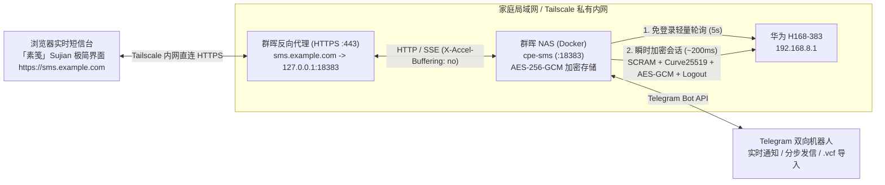

# cpe-sms

<p align="center">
  <strong>华为 5G CPE Ultra 6 (H168-383) 端到端加密短信网关 · 素笺 (Sujian) 实时网页中心 · Telegram 双向机器人</strong>
</p>

<p align="center">
  <strong>简体中文</strong> | <a href="README_EN.md">English</a>
</p>

<p align="center">
  <a href="https://github.com/cky008/cpe-sms/actions/workflows/ci.yml">
    
  </a>
  <a href="https://github.com/cky008/cpe-sms/pkgs/container/cpe-sms">
    
  </a>
  <a href="https://nodejs.org/">
    
  </a>
  <a href="https://www.typescriptlang.org/">
    
  </a>
  <a href="package.json">
    
  </a>
  <a href="test/">
    
  </a>
  <a href="AGENTS.md">
    
  </a>
  <a href="https://daisyui.com/">
    
  </a>
  <a href="https://tailwindcss.com/">
    
  </a>
  <a href="LICENSE">
    
  </a>
</p>

---

`cpe-sms` 是专为 **华为 5G CPE Ultra 6 (`H168-383`)** 打造的端到端短信管理与加密网关系统。采用 **Strict TypeScript** 编写，实现**全运行时零依赖**（100% 依赖 Node.js 原生 API），支持 CPE 路由器全自动安全鉴权与报文加解密。

系统提供 **Telegram 交互式双向机器人（支持分步发信与原生回信）**、基于 **daisyUI v5 的「素笺 (Sujian)」纸感极简实时网页中心（默认统一端口 `:18383`）**、**本地 AES-256-GCM 全盘静态加密归档**、**开放社区多语言系统 (`locales/*.json`)**、**54 国国际区号自动识别** 以及 **iPhone `.vcf` 通讯录导入**，专为家庭私有内网 NAS（群晖 DSM / Docker）与 **Tailscale + HTTPS 反向代理** 场景量身打造。

---

## 目录

- [✨ 核心特性](#-核心特性)
- [🏗️ 系统架构](#-系统架构)
- [📜「素笺」网页中心](#-素笺-sujian-极简网页中心)
- [🌐 多语言与社区翻译 (i18n)](#-多语言与社区翻译-i18n)
- [📶 设备与固件兼容性](#-设备与固件兼容性-hardware-compatibility)
- [🚀 快速上手](#-快速上手)
  - [1. 准备配置文件 (.env)](#1-准备配置文件-env)
  - [2. 群晖 NAS / Docker Compose 部署](#2-群晖-nas--docker-compose-部署)
  - [3. Tailscale 内网域名与 HTTPS 反向代理](#3-tailscale-内网域名与-https-反向代理)
  - [4. 本地源码运行与开发](#4-本地源码运行与开发)
- [📱 Telegram 机器人指南](#-telegram-机器人指南)
- [💻 CLI 命令行工具](#-cli-命令行工具)
- [⚙️ 配置说明](#-配置说明)
- [🧪 工程规范与测试门禁](#-工程规范与测试门禁)
- [❓ 常见问题排查 (FAQ)](#-常见问题排查-faq)
- [🤝 参与贡献](#-参与贡献-contributing)
- [⚠️ 免责声明](#-免责声明-disclaimer)
- [📄 开源许可证](#-开源许可证)

---

## ✨ 核心特性

- **🔐 零泄露静态存储加密（Encryption at Rest）**
  - 本地所有持久化存储（`data/state.json`、`data/sms-archive.json`、`data/contacts.json`）均通过 `scrypt` + 随机盐 `HKDF-SHA256` 派生独立子密钥，以 **`AES-256-GCM`** 加密并设置 `0600` 权限原子落盘，杜绝明文短信、验证码或通讯录落盘泄露。
- **🛡️ 华为 H168-383 协议通信与传输安全（In Transit）**
  - 完整实现华为 **SCRAM-SHA256** 登录握手与 **Curve25519 ECDH（大端无钳位）+ AES-256-GCM (`enc-type=1|2|3`)** 数据加解密，自动校验路由器 RSA-PSS 公钥签名。
  - **108006 熔断保护**：检测到密码错误 (`108006`) 或账户锁定 (`108007`) 时立即熔断终止，杜绝连续重试导致 CPE 锁定。
  - **瞬时加密会话**：平时仅调用免登录轻量接口轮询（每 5s 一次，支持让位网页登录）；仅在有新消息或收发操作时建立约 200ms 的瞬时会话并立即登出，绝不抢占浏览器访问 `http://192.168.8.1/#/sms`。
- **📜「素笺 (Sujian)」极简实时短信网页中心**
  - 基于 **daisyUI v5 + Tailwind CSS v4** 离线预编译（零外部 CDN 依赖，内网秒开）。
  - **彻底去除 Emoji 噪音**：全站内置 20+ 枚 `1.75px` 圆角线性矢量图标；收发气泡支持 5 分钟智能时间聚合；短信验证码提供等宽高亮胶囊与一键复制。
  - **4 套基底主题 × 9 种强调色**：内置晴昼（浅色）、宣纸（暖纸）、墨夜（深炭）、深黛（浓郁），配合双层明度校准的 9 种强调色，支持跟随系统深浅色平滑切换。
  - **开放多语言 (i18n) 社区架构**：支持简体中文与 English（跟随浏览器语言或外观菜单切换）；翻译文件位于 [`locales/*.json`](locales/)，社区贡献者只需添加新的语言 JSON 文件即可自动生成对应翻译。
  - **高位单端口收敛 (`:18383`)**：单一端口同时承载 Web 界面、SSE 实时事件流（`/api/events`）、健康检查（`/healthz`）与 REST API，避开群晖常见 `:8080` 冲突。
- **✍️ Telegram 双向通知与分步发信**
  - **分步发短信向导（`/new`）**：默认适配爱尔兰本地号（`+353`，自动标准化本地输入如 `083 123 4567` 为 E.164 格式），支持一键切换国际区号、模糊搜索联系人、实时预览短信编码及分段计费条数。
  - **原生「回复」回信**：长按或右键直接 Reply 机器人的任意短信通知卡片，即可将输入文字直接发送给该号码。
- **🌍 54 国国际区号分类 & iPhone `.vcf` 本地导入**
  - 智能分类真实个人手机号与字母品牌服务号（如 `Revolut`、`Three`、`Google`），自动提取短信中的验证码与正文品牌签名。
  - 支持将 iPhone / Mac 导出的 `.vcf` 通讯录文件直接发送给 Telegram 机器人或在网页端上传，本地加密存储并实时关联会话备注。
- **🚀 零运行时依赖（Zero Runtime Dependencies）**
  - 生产镜像基于 Node.js 22 Alpine，仅保留编译生成的纯 ESM 代码，无任何第三方生产依赖，体积精简，启动迅速。

---

## 🏗️ 系统架构



---

## 📜「素笺 (Sujian)」极简网页中心

<p align="center">
  
</p>
<p align="center">
  
</p>
<p align="center">
  
  
  
</p>

网页中心以“一纸素笺，见字如面”为核心理念，打造清爽克制、专注阅读与收发的纸感体验：

| 基底主题 | 风格定位 | 说明 |
| :--- | :--- | :--- |
| **晴昼 (`sujian-light`)** | 纯净浅色 | 留白充足，高对比度正文，适合明亮工作环境 |
| **宣纸 (`sujian-paper`)** | 护眼暖纸 | 柔和燕麦色背景与纸张触感，降低长时间阅屏疲劳 |
| **墨夜 (`sujian-dark`)** | 深炭暗色 | 遵循暗色层叠规范，侧边栏深沉、内容区微亮、悬浮卡片微抬升 |
| **深黛 (`sujian-midnight`)** | 浓郁午夜 | 接近 OLED 纯黑的深邃夜间模式，对比鲜明 |

- **9 种自适应强调色**：随主题（默认）、经典蓝、靛青、鸢尾紫、玫瑰粉、朱砂红、琥珀橙、松石绿、海湾青、石墨灰。
- **轻量微动效**：灵动悬浮新建按钮（`N` 快捷键直接调起，`/` 聚焦搜索框）、验证码点击复制状态切换、主题切换 320ms 平滑过渡，严格支持 `prefers-reduced-motion`。

---

## 🌐 多语言与社区翻译 (i18n)

`cpe-sms` 具备开放、可扩展且零外部依赖的多语言架构：

- **开箱即用双语支持**：默认内置 **简体中文 (`zh-CN`)** 与 **English (`en`)**，支持自动探测浏览器偏好，或在「外观」弹窗中实时无缝切换。
- **动态深度本地化**：
  - **时间与分组**：相对时间分组（今天、昨天、本周、本月 / Today, Yesterday, This Week, This Month）及短日期展示。
  - **短信编码与字数**：GSM-7 / UCS-2 短信编码实时计算与计费条数描述（如 `GSM-7 · 5 chars · 1 segment` / `GSM-7 · 5 字 · 1 条`）。
  - **国际国家目录**：54 国国际区号与国家名称即时适配（爱尔兰 / Ireland、中国大陆 / China 等）。
- **零延迟渲染与无闪烁 (Zero-FOUC)**：字典在编译期自动生成 TypeScript 强类型常量，首屏加载时同步渲染，内网或离线环境下无任何异步网络开销或布局跳变。

### 社区翻译贡献指南 (How to Contribute a New Language)

添加一种新语言极其简单，**无需修改任何 TypeScript 代码**：

1. **新建语言字典**：复制 [`locales/en.json`](locales/en.json) 或 [`locales/zh-CN.json`](locales/zh-CN.json) 为 `locales/<语言代码>.json`（例如 `locales/ja.json`），并在文件顶部更新 `_meta` 块：
   ```json
   {
     "_meta": {
       "name": "日本語",
       "code": "ja"
     },
     "app": { ... }
   }
   ```
2. **翻译字典键值**：翻译各分类下的文本内容，保留形如 `{count}`、`{phone}`、`{who}`、`{code}` 的插值变量。
3. **执行编译与自动校验**：
   ```bash
   npm run build
   npm test
   ```
   构建流水线（[`scripts/build-locales.ts`](scripts/build-locales.ts)）会自动扫描 `locales/` 目录并注册新语言，单元测试会自动校验新字典与基准字典的 100% 键对齐。
4. **提交 PR**：详见 [CONTRIBUTING.md#7-contributing-translations-i18n](CONTRIBUTING.md)。

---

## 🚀 快速上手

### 1. 准备配置文件 (`.env`)

复制示例配置并填入你的 CPE 与 Telegram 信息：

```bash
cp .env.example .env
```

核心配置项示例：

```dotenv
# CPE 连接配置
CPE_URL=http://192.168.8.1
CPE_PASSWORD=你的CPE管理后台登录密码

# Telegram 机器人
TELEGRAM_API=你的Telegram机器人Token

# 默认电话国家区号（默认爱尔兰 +353，输入本地手机号自动补全）
DEFAULT_COUNTRY_CODE=+353

# 网页中心服务端口（默认 18383，避免占用 NAS 8080）
WEB_ENABLED=true
WEB_PORT=18383
```

---

### 2. 群晖 NAS / Docker Compose 部署

推荐直接使用 GitHub Container Registry 预构建的多架构镜像（支持 `linux/amd64` 与 `linux/arm64`），避免在低功耗 NAS 上本地编译耗时：

```yaml
# docker-compose.yml 示例（使用预构建镜像）
services:
  cpe-sms:
    image: ghcr.io/cky008/cpe-sms:latest
    container_name: cpe-sms
    restart: unless-stopped
    env_file:
      - .env
    ports:
      - "18383:18383"
    volumes:
      - ./data:/app/data
```

启动容器（内置以非 root `node` 用户执行，并通过 `su-exec` 自动维护挂载目录权限）：

```bash
# 方式 A：直接拉取预构建镜像启动（推荐）
sudo docker compose up -d

# 方式 B：本地多阶段编译启动
sudo docker compose up -d --build
```

- **网页端访问**：直接在局域网内打开 `http://<NAS_IP>:18383`，默认使用 `CPE_PASSWORD` 登录。
- **仅保留 Telegram 机器人**：若无需网页界面，可在 `.env` 中设置 `WEB_ENABLED=false` 后重启容器。

---

### 3. Tailscale 内网域名与 HTTPS 反向代理

推荐配合 **Tailscale 私有内网** 与 **群晖反向代理**，实现零公网端口暴露的安全访问：

1. **DNS 解析配置（Cloudflare）**：
   - 添加 A 记录：主机名 `sms`，IPv4 地址填入群晖 NAS 的 **Tailscale IP**（如 `100.64.x.y`）。
   - 代理状态设为 **仅限 DNS（灰色云朵 `DNS only`）**。
2. **群晖 DSM 配置反向代理服务器**：
   - 打开 **控制面板 -> 登录门户 -> 高级 -> 反向代理服务器 -> 新增**：
     - **来源**：协议 `HTTPS`，主机名 `sms.yourdomain.com`，端口 `443`，勾选「启用 HSTS」。
     - **目的地**：协议 `HTTP`，主机名 `127.0.0.1`，端口 `18383`。
   - 打开 **控制面板 -> 安全性 -> 证书 -> 设置**，将 `sms.yourdomain.com` 关联至你的 SSL 证书。
3. **完成配置**：访问 `https://sms.yourdomain.com` 即可享受原生 HTTPS Cookie 安全隔离与 SSE 实时推送。

---

### 4. 本地源码运行与开发

要求运行环境为 **Node.js `>= 22.6.0`**：

```bash
# 1. 安装开发编译依赖
npm install

# 2. 编译 TypeScript 与样式
npm run build

# 3. 运行本地常驻守护进程
npm start

# 4. 执行全套类型检查、覆盖率测试与安全审计
npm run check
```

---

## 📱 Telegram 机器人指南

首次使用前，在 Telegram 向机器人发送 `/auth 你的CPE登录密码` 即可完成授权绑定（发送的明文密码消息会自动撤回，授权 Chat ID 经过加密保存在 `data/state.json`）。

| 指令 / 交互 | 说明 |
| :--- | :--- |
| **`/new`**（或点击「发短信」） | **分步发短信向导**：支持切换区号、搜索联系人、输入正文并实时预览条数确认发送 |
| **直接「回复 (Reply)」消息** | 在任意短信通知卡片上右键或长按回复内容，即可直接回信给该号码 |
| **发送 `.vcf` 文件** | 将 iPhone / Mac 导出的通讯录文件发送给机器人，自动完成加密解析与入库 |
| `/inbox` | 查看最近会话列表与未读状态 |
| `/unread` | 查看所有未读短信及提取出的验证码 |
| `/chat <号码或服务号>` | 展开与指定号码的历史对话流 |
| `/send <号码> <内容>` | 一行指令快速发送短信 |
| `/contact <号码> <备注>` | 为指定号码设置或更新联系人姓名 |
| `/contacts [关键词]` | 搜索或翻页查看已导入的加密通讯录 |
| `/status` | 查询当前 CPE 5G 信号强度与短信存储容量 |
| `/sync` | 立即触发一次全量短信同步归档 |

### 预览 Telegram 交互卡片样式

无需连接 CPE 路由器或发送真实短信，即可在本地渲染 Telegram 排版效果：

```bash
# 终端内预览字符排版
npm run preview:telegram

# （可选）向独立测试 Bot 发送真实 Telegram 样式预览
TELEGRAM_PREVIEW_TOKEN='123456:TEST_TOKEN' \
TELEGRAM_PREVIEW_CHAT_ID='你的测试ChatID' \
npm run preview:telegram -- --send
```

---

## 💻 CLI 命令行工具

可通过 Node.js 直接执行 CLI 工具进行诊断与运维：

```bash
npm run cpe:status                           # 查询 CPE 5G 信号、漫游状态与短信容量
npm run cpe:sync                             # 全量拉取短信并写入加密归档 data/sms-archive.json
npm run cpe:inbox                            # 终端展示最近会话列表（含国家/服务号识别）
npm run cpe:unread                           # 终端展示未读短信列表
npm run cpe:send -- 0831234567 "你好！"      # 发送短信（自动规范化爱尔兰本地号）
npm run cpe:import-vcf -- ./Contacts.vcf     # 导入本地 vCard 通讯录文件
```

---

## ⚙️ 配置说明

所有配置均通过环境变量或根目录 `.env` 文件提供（完整定义详见 [`.env.example`](.env.example)）：

| 变量名 | 默认值 | 说明 |
| :--- | :--- | :--- |
| `CPE_URL` | `http://192.168.8.1` | 华为 CPE Ultra 6 管理地址 |
| `CPE_USERNAME` | `admin` | CPE 登录用户名 |
| `CPE_PASSWORD` | - | CPE 登录密码（必需） |
| `DATA_ENCRYPTION_KEY` | 默认回退至 `CPE_PASSWORD` | 本地 `data/*.json` 静态存储 AES-256-GCM 根密钥 |
| `TELEGRAM_API` | - | Telegram Bot Token（必需） |
| `TELEGRAM_CHAT_IDS` | - | 预设授权 Chat ID（支持多个逗号分隔；亦支持 `TELEGRAM_CHAT_ID` 或通过 `/auth` 动态绑定） |
| `DEFAULT_COUNTRY_CODE` | `+353` | 默认国家区号（爱尔兰），本地无前缀手机号自动规范化为 E.164 |
| `WEB_ENABLED` | `true` | 是否启用内置网页中心 |
| `WEB_PORT` | `18383` | 网页中心与统一 API 监听端口（避让 `:8080`） |
| `POLL_INTERVAL_MS` | `5000` | 免登录通知轮询间隔（毫秒） |
| `FULL_SYNC_INTERVAL_MS`| `60000` | 完整历史归档同步兜底周期（毫秒） |

---

## 🧪 工程规范与测试门禁

本项目开发严格践行 **测试驱动开发（TDD）** 与 **零密钥泄露** 规范，详见 [`AGENTS.md`](AGENTS.md)。

### 本地质量门禁

在提交任何代码前，必须执行全套门禁并通过：

```bash
npm run build && npm run check
```

门禁包含三项强制流水线：
1. **`npm run typecheck`**：Node.js 后端与浏览器 DOM 前端严格类型检查。
2. **`npm run test:coverage`**：`node:test` + `c8` 强制测试覆盖率门槛（语句 `>= 90%`、行数 `>= 90%`、函数 `>= 95%`）。
3. **`npm run audit:secrets`**：深度扫描所有 Git 追踪文件及 `git log -p --all` 全量历史，阻断任何真实密钥、Token 或明文数据。

### CI/CD 流水线

项目配置了 [GitHub Actions CI](.github/workflows/ci.yml)，在每次代码推送到 `main` 分支或提交 Pull Request 时自动运行：
- **测试与门禁作业**：在 Ubuntu 环境基于 Node.js 22 执行依赖安装、资源编译及全量门禁检查。
- **容器镜像构建作业**：基于 `Dockerfile` 执行多阶段容器构建冒烟验证，确保发布产物零依赖且可重现。

---

## 📶 设备与固件兼容性 (Hardware Compatibility)

- **官方已验证设备**：
  - **华为 5G CPE Ultra 6 (`H168-383`)**（固件版本 HarmonyOS / EMUI 11.x 及以上）
- **架构兼容性说明**：
  - 本项目的协议通信层基于华为现代 CPE 的 **SCRAM-SHA256** 登录握手与 **Curve25519 ECDH + AES-256-GCM** 加密协议构建，并具备 `108006` 密码防暴力破解熔断机制。
  - 理论上适用于搭载相同 Web 管理接口与加密协议的其他华为 CPE / 移动路由器系列（如 `H158-381`、`H155-381`、`H138-380`、`H122-373`、`B818` 等）。
  - 如果你在其他华为路由器型号上成功运行或遇到协议兼容问题，非常欢迎提交 [Issue](https://github.com/cky008/cpe-sms/issues) 或 Pull Request 帮助丰富兼容设备列表！

---

## ❓ 常见问题排查 (FAQ)

<details>
<summary><strong>Q: 启动日志输出 <code>108006 熔断保护终止</code> 是什么原因？</strong></summary>

> **A**: 这是华为 CPE 管理密码错误的安全保护机制。在华为 H168-383 固件上，**密码连续输错 3 次会导致 CPE 管理后台被强制锁定 2 小时**。`cpe-sms` 内置了熔断保护，一旦收到 `108006`（密码错误）或 `108007`（账户已锁）立即熔断退出，绝不自动重试。请检查 `.env` 文件中的 `CPE_PASSWORD` 是否正确。
</details>

<details>
<summary><strong>Q: 群晖 NAS Docker 挂载 <code>./data</code> 目录时报错权限不足 (EACCES)？</strong></summary>

> **A**: 容器镜像内置了 `su-exec` 与 `docker-entrypoint.sh` 入口脚本。启动时会自动将挂载的 `/app/data` 目录属主更正为非 root 的 `node:node` 用户，并设置 `0700` 目录权限。如果使用群晖 Container Manager，请确保挂载的宿主机文件夹具备基本读写权限。
</details>

<details>
<summary><strong>Q: 为什么默认端口选用 <code>18383</code> 而不是标准的 <code>8080</code>？</strong></summary>

> **A**: 群晖 DSM 默认服务、Portainer、qBittorrent 等常见 NAS 套件经常占用 `8080` 端口。`cpe-sms` 默认采用高位独立端口 `18383`（寓意 H168-383），并整合了 Web 前端、SSE 实时推送流、REST API 与 `/healthz` 健康检查，单个端口全功能收敛。
</details>

<details>
<summary><strong>Q: 在配置反向代理后，网页端为什么无法实时接收新短信通知？</strong></summary>

> **A**: 网页端通过 SSE（`/api/events`）长连接接收实时事件。部分反向代理（如 Nginx 或群晖反向代理）默认开启了响应缓存缓冲（Proxy Buffering）。请确保在反向代理中配置了 `proxy_buffering off;`，或确认响应头中带有 `X-Accel-Buffering: no`（本项目已默认输出此 Header）。
</details>

<details>
<summary><strong>Q: 短信加密归档的密钥丢失了怎么办？</strong></summary>

> **A**: 所有持久化数据（`data/*.json`）均使用 `DATA_ENCRYPTION_KEY`（未配置时默认使用 `CPE_PASSWORD`）经 `scrypt` + `AES-256-GCM` 静态加密。若修改了密码导致解密失败，切换回旧密钥即可重新解密。绝不向公网或云端上传任何数据。
</details>

---

## 🤝 参与贡献 (Contributing)

热烈欢迎各种形式的开源贡献！无论是报告 Bug、提出新功能建议、适配更多型号的华为路由器，还是贡献多语言翻译：

1. **阅读贡献指南**：请在开始前查阅 [CONTRIBUTING.md](CONTRIBUTING.md)，了解开发环境配置、Conventional Commits 提交规范及 TDD 测试驱动工作流。
2. **测试与安全门禁**：所有提交与 Pull Request 必须通过 `npm run build && npm run check`（含严格类型检查、`>= 90%` 覆盖率及零密钥泄露审计）。
3. **安全漏洞反馈**：发现潜在安全漏洞请遵循 [SECURITY.md](SECURITY.md) 政策，避免在公开 Issue 中讨论敏感细节。

---

## ⚠️ 免责声明 (Disclaimer)

1. **用途限制**：本项目仅供合法持有华为 5G CPE Ultra 6 (`H168-383`) 设备管理权限的个人用户用于家庭网络自动化、私有短信归档与自用研究学习。
2. **禁止滥用**：严禁将本软件用于任何垃圾短信轰炸 (SMS Bombing / Spamming)、未授权批量营销、电信诈骗、未授权渗透测试或违反所在地电信法律法规的非法活动。
3. **网络安全警示**：请勿将未鉴权或未配置 HTTPS 反向代理的容器端口直接裸露暴露于公网（Internet）。强烈建议通过 Tailscale / WireGuard 等加密内网访问，或配置具有强密码与 HSTS 的反向代理。
4. **非官方声明**：本项目属于独立个人开源项目，与华为技术有限公司（Huawei Technologies Co., Ltd.）或任何电信运营商无官方关联、赞助或背书关系。开发者不对任何因使用、修改或衍生本软件造成的硬件故障、账户锁定或数据损坏承担法律责任。

---

## 📄 开源许可证

本项目基于 [PolyForm Noncommercial License 1.0.0](LICENSE) 许可协议发布。允许自由用于个人学习、学术研究、家庭部署与非商业用途。
