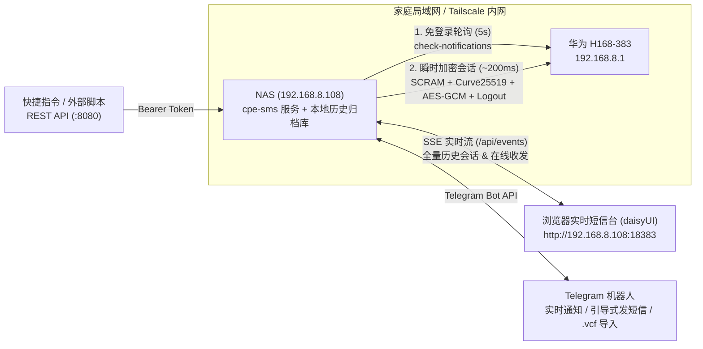

# cpe-sms — 华为 5G CPE Ultra 6 (H168-383) 短信网关 · Telegram 机器人 · daisyUI 实时网页中心

专为 **华为 5G CPE Ultra 6 (`H168-383`)** 打造的全功能短信收发与归档系统。支持自动完成 CPE 管理后台鉴权与报文加解密，提供 **Telegram 双向机器人（含引导式发短信向导）**、基于 **`daisyui` 包构建的高位端口实时网页中心（默认 `:18383`，可选开关）**、**全量历史短信本地归档**、**54 国国际区号识别** 以及 **iPhone `.vcf` 通讯录本地导入**，非常适合部署在局域网 NAS（如 `192.168.8.108`）并结合 **Tailscale** 随时随地访问。

---

## 核心特性

- **🌼 可选开启的 daisyUI 实时短信网页中心（高位端口 `:18383`）**
  - 基于官方 **`daisyui` (v5) + Tailwind CSS v4** npm 包编译打包（零外部 CDN 依赖，内网离线秒开，内置 `Light` / `Dark` / `Nord` / `Emerald` / `Dim` / `Cupcake` 6 款主题切换）。
  - **全量历史短信归档**：自动分页拉取 CPE 内**全部历史收件箱与发件箱短信**持久化至本地 `data/sms-archive.json`（实测 185 条历史短信全量加密拉取仅需 ~400ms），即便日后清理了 CPE 500 条上限的存储，历史记录依然完整保留。
  - **SSE 毫秒级实时推送**：基于 `/api/events` (Server-Sent Events)，收到新短信、验证码或发出短信时网页对话流实时自动刷新并弹出通知，无需手动刷新。
  - **灵活可选开关**：可通过 `.env` 的 `WEB_ENABLED=true|false` 一键开关，也支持通过 `docker compose --profile web up -d` 独立拉起或关停网页容器。
- **✍️ Telegram 引导式发短信向导 & 原生回复发信**
  - **分步引导式发信（`/new` 或点击 `✍️ 引导式发送短信` 按钮）**：
    1. **选择/输入接收方**：默认采用 **🇮🇪 爱尔兰区号 (`+353`)**，输入本地号码（如 `083 123 4567`）自动剥离前导 `0` 规范化为 `+353831234567`；同时提供 **🇨🇳 中国 `+86` / 🇬🇧 英国 `+44` / 🇺🇸 美加 `+1` / 🇭🇰 香港 `+852`** 一键切换按钮，或直接输入任意带 `+` / `00` 的国际号码，或直接输入**联系人姓名**搜索。
    2. **输入正文与发送前预览**：自动计算 `GSM 7-bit` / `UCS-2` 编码与短信分段条数，展示收件人归属地预览卡片，点击「🚀 确认立即发送」后执行发送并轮询运营商回执。
  - **直接「回复」通知即发短信**：长按/右键「回复 (Reply)」任意一条短信通知卡片即可直接回信。
- **🌍 发件人身份、国家区号识别与 iPhone 通讯录导入**
  - **自动国家/来源识别**：内置 54 个常见国家/地区区号库与国旗标识（如 `🇮🇪 爱尔兰 +353`、`🇨🇳 中国大陆 +86`、`🇬🇧 英国 +44`），自动区分字母品牌服务号（如 `🏢 Three`、`Apple`、`Revolut`）、运营商短号（`📟 50272`）、中国 `106` 通道号，并自动提取正文中的 `【品牌签名】`。
  - **零云端隐私泄露的 iPhone 通讯录支持（可选）**：支持将 iPhone 导出的 `.vcf` (vCard) 文件**直接发送给 Telegram 机器人**或在 **Web 网页端上传**，自动解析 Apple `item1.TEL` 与 UTF-8 Quoted-Printable 中文姓名，保存在本地 `data/contacts.json`，自动跨格式匹配 `083xxxxxxx` 与 `+35383xxxxxxx`。
- **🔐 原生完整协议通信 & 浏览器零冲突共存**
  - 完整实现 H168-383 固件的**华为非标 SCRAM-SHA256** 握手与 **Curve25519 ECDH（大端无钳位）+ AES-256-GCM (`enc-type=1|2|3`)** 接口加解密。
  - 平时每 5 秒调用**免登录**接口 `/api/monitoring/check-notifications`，仅在有新短信或收发操作时建立 ~200ms 瞬时会话并立即登出，绝不抢占浏览器访问 `http://192.168.8.1/#/sms`，遇到密码错误 (`108006`) 立即熔断防锁定。

---

## 架构概览



---

## 快速开始

### 1. 配置文件（`.env`）

```bash
cp .env.example .env
```

核心配置示例（完整说明见 [`.env.example`](.env.example)）：

```dotenv
CPE_URL=http://192.168.8.1
CPE_PASSWORD=你的CPE管理界面密码
TELEGRAM_API=你的Telegram机器人Token

# 默认电话国家区号（默认爱尔兰 +353）
DEFAULT_COUNTRY_CODE=+353

# 🌼 实时网页开关与高位端口（可选开启或关闭）
WEB_ENABLED=true
WEB_PORT=18383
```

---

### 2. NAS (`192.168.8.108`) Docker Compose 部署（两种可选网页模式）

#### 方式 A：单容器一体化运行（默认推荐）
当 `.env` 中 `WEB_ENABLED=true`（默认）时，一条命令同时拉起短信监听、Telegram Bot 与 `:18383` 实时网页（若不想开启网页，只需改 `WEB_ENABLED=false`）：

```bash
docker compose up -d --build
```
- 实时网页地址：`http://192.168.8.108:18383`（连上 Tailscale 在外网同样直接访问，登录密码即 `CPE_PASSWORD`）。
- 首次启动会自动从 H168-383 拉取全部历史收发件箱短信存入 `./data/sms-archive.json`。

#### 方式 B：主服务与网页容器按需解耦拉起（Compose Profile 模式）
如果你希望主后台服务完全不暴露网页（`.env` 设置 `WEB_ENABLED=false`），仅在需要看网页时单独拉起前端容器：

```bash
# 仅启动后台短信监听 + Telegram 机器人
WEB_ENABLED=false docker compose up -d

# 需要网页时，随时一行命令连同网页容器一起拉起（默认映射 18384，或设 WEB_STANDALONE_PORT=18383）
docker compose --profile web up -d

# 用完随时单独关停网页容器，不影响后台机器人
docker compose --profile web stop cpe-sms-web
```

---

### 3. 本地 / 命令行运行（Node.js >= 20）

运行时**零生产环境外部依赖**（预编译好的 daisyUI 样式已内置于 `src/web/public/app.css`）：

```bash
# 启动完整守护服务（短信轮询 + Telegram Bot + :18383 daisyUI 实时网页 + :8080 REST API）
npm start

# 手动全量同步 CPE 所有历史短信到本地 data/sms-archive.json
npm run cpe:sync

# 查看 CPE 5G 信号与短信容量
npm run cpe:status

# 查看最近会话（带国家国旗、区号与联系人姓名识别）
npm run cpe:inbox

# 发送短信（默认 +353 爱尔兰本地号自动补全，或传任意 +国际号码）
npm run cpe:send -- 0831234567 "Hello from H168-383"
npm run cpe:send -- +8613800138000 "你好！"

# 导入 iPhone / Mac 导出的 .vcf 通讯录文件
npm run cpe:import-vcf -- ./Contacts.vcf

# 若修改了前端 HTML/CSS，重新编译 daisyUI 样式包
npm install && npm run build:css
```

---

## Telegram 机器人使用指南

首次在 Telegram 打开机器人发送 `/auth 你的CPE登录密码` 即可自动完成绑定（含密码的消息会自动撤回删除）。

| 指令 / 交互 | 功能说明 |
| :--- | :--- |
| **`/new`**（或点击 `✍️ 引导式发送短信`） | **交互式分步发短信**：默认 `🇮🇪 +353` 爱尔兰号码，按钮一键切 `+86` / `+44` / `+1` / `+852` 或搜联系人姓名 -> 输入内容 -> 预览确认发送 |
| **直接「回复」短信卡片** | 长按/右键回复任意通知或对话消息，输入内容直接回信给对方号码 |
| **直接发送 `.vcf` 文件** | 把 iPhone 导出的通讯录 `.vcf` 文件直接发给机器人，自动导入本地联系人库 |
| `/inbox` | 分页查看最近短信联系人会话（显示联系人姓名、国家国旗与区号） |
| `/unread` | 查看最近未读短信与自动提取的验证码，支持一键标为已读 |
| `/chat <号码或服务号>` | 查看与某号码（如 `+35383...`、`Three`、`Apple`）的历史对话 |
| `/send <号码> <内容>` | 一行命令快速发短信（无参数发送 `/send` 也会自动进入引导式向导） |
| `/contact <号码> <姓名>` | 手动给号码添加或修改姓名备注（如 `/contact 0831234567 房东Sean`） |
| `/contacts [关键词]` | 查看或搜索本地已保存的通讯录联系人 |
| `/status` | 查看 H168-383 在线状态、运营商、5G/4G 信号与收件箱及本地归档统计 |
| `/sync` | 立即全量同步 CPE 历史收发件箱短信到本地归档库 |

---

## 关于是否需要同步 iPhone 通讯录的建议

- **收验证码 / 运营商 / 银行 / 快递平台通知：完全不需要同步通讯录。**
  - 绝大多数机构短信直接使用**字母品牌发送号**（如 `Three`、`Apple`、`Revolut`、`DHL`）或在正文附带 `【品牌签名】`，本系统已内置自动识别与 54 国国际区号+国旗标注，一眼就能看清来源。
- **亲友 / 房东 / 同事私人手机号往来，或想按名字发短信：可选按需导入，无需绑定 iCloud。**
  - 如果只有寥寥几个常用私人号码，直接用 `/contact 083xxxxxxx 房东` 或在网页端点击「✏️ 备注联系人」即可。
  - 如果私人联系人较多，只需在 iPhone 打开系统「**通讯录 (Contacts)**」App -> 左上角返回「**列表 (Lists)**」-> 长按「**所有联系人**」选择「**导出 (Export)**」-> 直接通过 Telegram 发送给你的机器人（或在 `:18383` 网页端上传）。数据 100% 仅保存在你 NAS 本地的 `data/contacts.json` 中。

---

## 测试

运行完整自动化测试套件（共 16 项测试，涵盖 Curve25519、SCRAM、AES-256-GCM、爱尔兰 `+353` 及多国号码规范化、iPhone `.vcf` Quoted-Printable 解析、daisyUI Web 服务与 SSE 实时流、Telegram 引导式发短信向导）：

```bash
npm test
```
