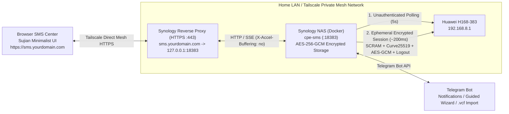
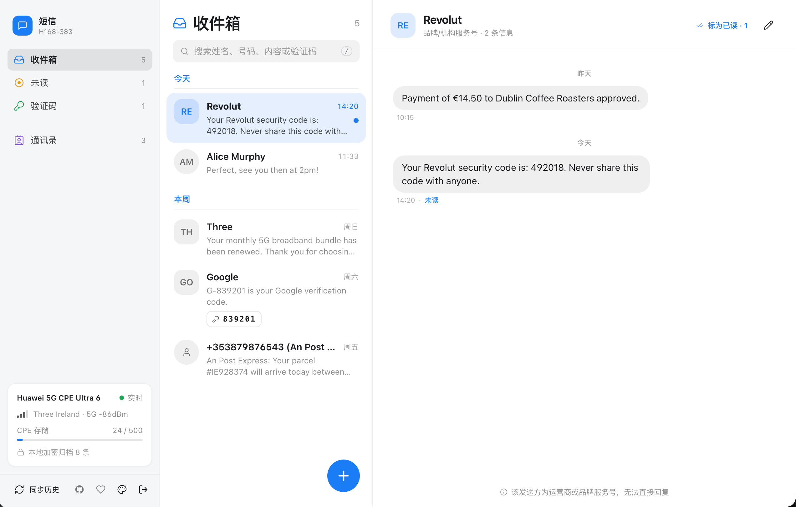
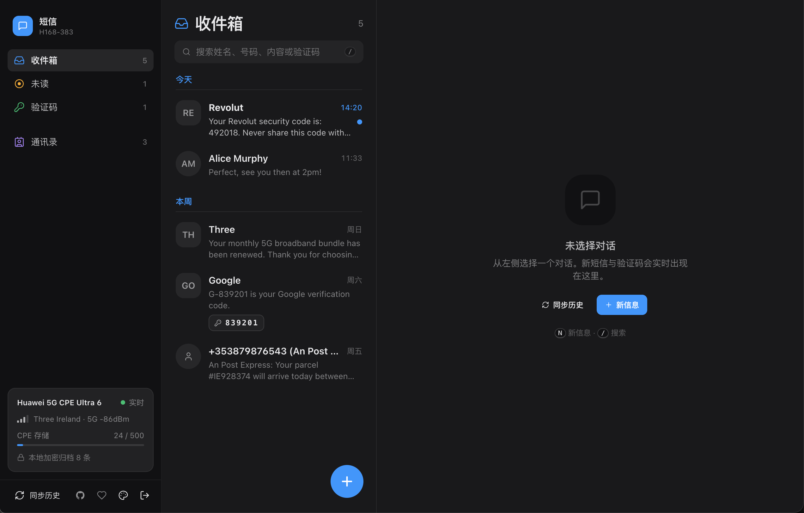
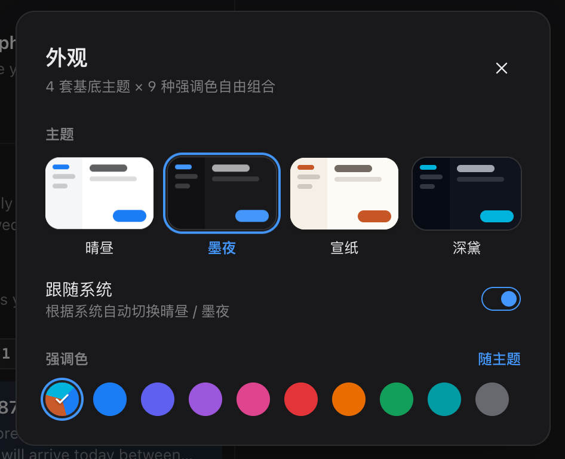
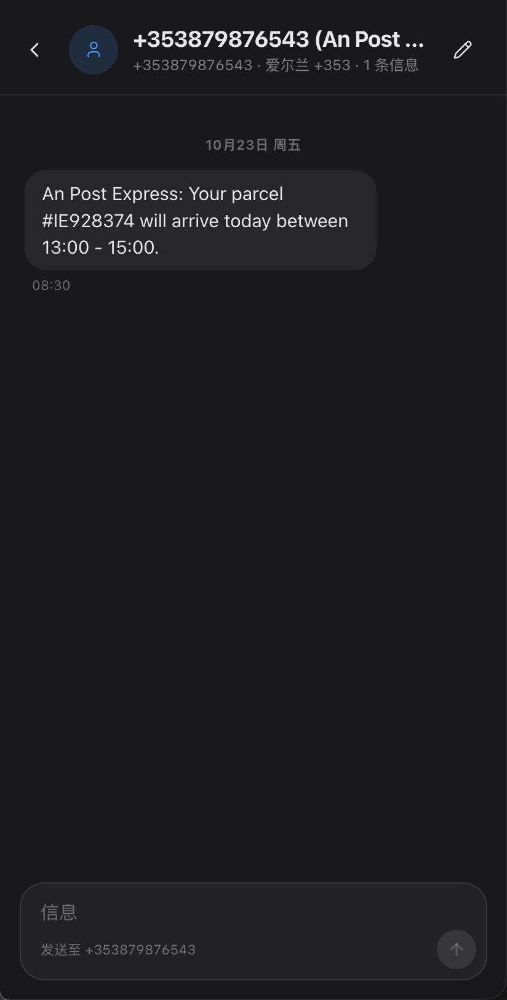
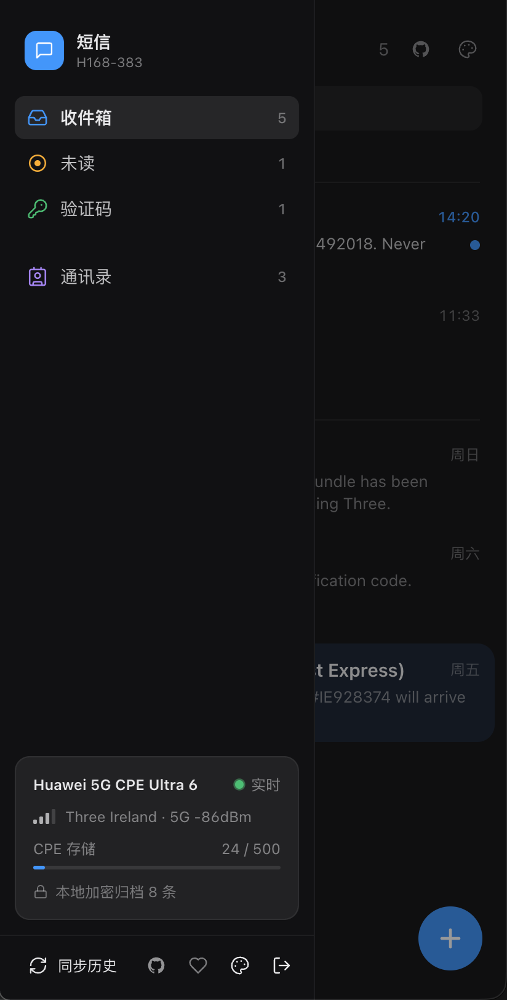

# cpe-sms

<p align="center">
  <strong>Huawei 5G CPE Ultra 6 (H168-383) End-to-End Encrypted SMS Gateway · Sujian (素笺) Real-Time Web Center · Telegram Two-Way Bot</strong>
</p>

<p align="center">
  <a href="README.md">简体中文</a> | <strong>English</strong>
</p>

<p align="center">
  <a href="https://github.com/cky008/cpe-sms/actions/workflows/ci.yml">
    
  </a>
  <a href="https://nodejs.org/">
    
  </a>
  <a href="https://www.typescriptlang.org/">
    
  </a>
  <a href="package.json">
    
  </a>
  <a href="test/">
    
  </a>
  <a href="AGENTS.md">
    
  </a>
  <a href="https://daisyui.com/">
    
  </a>
  <a href="https://tailwindcss.com/">
    
  </a>
  <a href="Dockerfile">
    
  </a>
  <a href="LICENSE">
    
  </a>
</p>

---

`cpe-sms` is an end-to-end encrypted SMS gateway, historical archive, and real-time management center built specifically for the **Huawei 5G CPE Ultra 6 (`H168-383`)** router. Written in **Strict TypeScript** with **zero production runtime dependencies** (relying 100% on Node.js built-in APIs), it handles full router SCRAM authentication and wire-level protocol cryptography automatically.

The system provides a **two-way interactive Telegram Bot (with step-by-step send wizard and direct reply-to-send)**, the **"Sujian (素笺)" paper-like minimalist real-time Web Center based on daisyUI v5 (defaulting to unified port `:18383`)**, **local AES-256-GCM full-storage encryption at rest**, **54-country dial code directory & brand sender classifier**, and **iPhone `.vcf` contact book import**, designed for private NAS environments (Synology DSM / Docker) and **Tailscale + HTTPS reverse proxy** topologies.

---

## Table of Contents

- [Key Features](#-key-features)
- [Architecture](#-architecture)
- [Sujian (素笺) Web Center](#-sujian-素笺-web-center)
- [Quick Start](#-quick-start)
  - [1. Configuration (.env)](#1-configuration-env)
  - [2. Docker Compose / Synology NAS Deployment](#2-docker-compose--synology-nas-deployment)
  - [3. Tailscale Mesh Network & HTTPS Reverse Proxy](#3-tailscale-mesh-network--https-reverse-proxy)
  - [4. Local Development & TDD Quality Gates](#4-local-development--tdd-quality-gates)
- [Telegram Bot Guide](#-telegram-bot-guide)
- [CLI Reference](#-cli-reference)
- [Configuration Reference](#-configuration-reference)
- [Engineering Standards & CI/CD](#-engineering-standards--cicd)
- [Disclaimer](#-disclaimer)
- [License](#-license)

---

## ✨ Key Features

- **🔐 Zero-Leakage Encryption at Rest & In Transit**
  - **Storage at rest**: All persistent files (`data/state.json`, `data/sms-archive.json`, `data/contacts.json`) are encrypted using `scrypt` + fresh salt `HKDF-SHA256` subkeys with **`AES-256-GCM`** and written atomically with `0600` permissions. No plaintext SMS, OTP code, or phone number ever touches disk.
  - **CPE transport security**: Complete implementation of Huawei **SCRAM-SHA256** login handshake, router RSA-PSS public key signature verification, and **Curve25519 ECDH (big-endian unclamped) + AES-256-GCM (`enc-type=1|2|3`)** payload encryption.
  - **Circuit breaker on `108006` / `108007`**: Immediately aborts on wrong password (`108006`) or locked account (`108007`) to prevent router lockout on `H168-383`.
  - **Zero-conflict ephemeral sessions**: Uses unauthenticated lightweight polling every 5s; only holds an authenticated session for ~200ms when handling messages and logs out immediately via `finally`, avoiding blocking browser logins at `http://192.168.8.1/#/sms`.
- **📜 "Sujian (素笺)" Minimalist Real-Time Web Center**
  - Built with **daisyUI v5 + Tailwind CSS v4** (compiled offline, zero CDN dependencies, instant LAN loading).
  - **Zero-emoji typographic design**: 20+ custom `1.75px` stroke vector SVG icons; 5-minute message bubble aggregation; monospace OTP badges with one-click copy.
  - **4 Base Themes × 9 Accent Colors**: Sujian Light (pure light), Sujian Paper (warm oat paper), Sujian Dark (charcoal dark), and Sujian Midnight (deep night) with dual-curve luminance tuning for dark and light backgrounds, supporting auto system dark/light switching.
  - **Extensible Community i18n**: Out-of-the-box English and Simplified Chinese support (matches browser locale or manually switched in Appearance); community contributors can add any language by dropping a single [`locales/<lang>.json`](locales/) file.
  - **High-port consolidation (`:18383`)**: Serves web UI, SSE event streams (`/api/events`), health checks (`/healthz`), and REST API on a single port, avoiding common NAS `:8080` collisions.
- **✍️ Two-Way Telegram Bot & Guided Send Wizard**
  - **Guided wizard (`/new`)**: Interactive step-by-step sender with country dial code switching, contact name search, and message encoding preview (GSM 7-bit vs UCS-2) with segment counts before sending.
  - **Native reply-to-send**: Long-press or right-click to reply to any notification message to directly send an SMS back to the sender.
- **🌍 54-Country Classifier & iPhone `.vcf` Import**
  - Distinguishes real personal phone numbers from alphanumeric brand sender IDs (e.g., `Revolut`, `Three`, `Google`, `Apple`) and extracts verification codes (OTPs).
  - Directly send an exported iPhone `.vcf` file to the Telegram bot or upload via Web Center to import and encrypt contacts locally.
- **🚀 Zero Runtime Dependencies**
  - Production container image is built on Node.js 22 Alpine containing zero production `node_modules`, achieving rapid cold boot and minimal attack surface.

---

## 🏗️ Architecture



---

## 📜 Sujian (素笺) Web Center

<p align="center">
  
</p>
<p align="center">
  
</p>
<p align="center">
  
  
  
</p>

The Web Center follows the philosophy of "Sujian" (素笺 — plain silk letter paper), prioritizing calm reading and distraction-free messaging:

| Base Theme | Visual Style | Description |
| :--- | :--- | :--- |
| **Sujian Light (`sujian-light`)** | Pure Daylight | High contrast, spacious whitespace for bright workspaces |
| **Sujian Paper (`sujian-paper`)** | Warm Paper | Warm oat tone and subtle paper texture, gentle on the eyes |
| **Sujian Dark (`sujian-dark`)** | Charcoal Dark | Strict dark layer hierarchy: deeper sidebar, elevated surfaces |
| **Sujian Midnight (`sujian-midnight`)** | Deep Midnight | High-contrast deep night mode ideal for OLED displays |

- **9 Adaptive Accent Colors**: Theme Default, Classic Blue, Indigo, Purple, Rose, Vermilion Red, Amber Orange, Teal, Gulf Cyan, Graphite Gray.
- **Subtle Micro-Interactions**: Floating action button (`N` shortcut to compose, `/` to focus search), OTP copy feedback animation, 320ms smooth theme transition, and strict `prefers-reduced-motion` compliance.

---

## 🚀 Quick Start

### 1. Configuration (`.env`)

Copy the template configuration:

```bash
cp .env.example .env
```

Key environment variables:

```dotenv
# Router credentials
CPE_URL=http://192.168.8.1
CPE_PASSWORD=your_cpe_admin_password

# Telegram Bot Token (from @BotFather)
TELEGRAM_API=your_telegram_bot_token

# Default Country Code (e.g., +353, +86, +44, +1, +852)
DEFAULT_COUNTRY_CODE=+353

# Timezone (defaults to UTC)
TZ=UTC

# High-port Web Center (defaults to 18383)
WEB_ENABLED=true
WEB_PORT=18383
```

---

### 2. Docker Compose / Synology NAS Deployment

You can use the pre-built multi-architecture container images from GitHub Container Registry (supporting `linux/amd64` and `linux/arm64`) directly without compiling on low-powered NAS devices:

```yaml
# docker-compose.yml example (using pre-built image)
services:
  cpe-sms:
    image: ghcr.io/cky008/cpe-sms:latest
    container_name: cpe-sms
    restart: unless-stopped
    env_file:
      - .env
    ports:
      - "18383:18383"
    volumes:
      - ./data:/app/data
```

Start the container (runs securely as unprivileged `node` user with `su-exec` managing volume permissions):

```bash
# Option A: Pull and start using the pre-built image (Recommended)
sudo docker compose up -d

# Option B: Build locally from source
sudo docker compose up -d --build
```

- **Web Center Access**: Navigate to `http://<NAS_IP>:18383` on your local network (login password defaults to `CPE_PASSWORD`).
- **Headless Mode**: Set `WEB_ENABLED=false` in `.env` if you only want the background Telegram Bot.

---

### 3. Tailscale Mesh Network & HTTPS Reverse Proxy

Achieve secure, zero-public-port access over Tailscale:

1. **DNS Setup (Cloudflare)**:
   - Add an A record: Hostname `sms`, IPv4 pointing to your NAS's **Tailscale IP** (e.g., `100.64.x.y`).
   - Proxy status: **DNS only (gray cloud)**.
2. **Synology DSM Reverse Proxy**:
   - Open **Control Panel -> Login Portal -> Advanced -> Reverse Proxy -> Create**:
     - **Source**: Protocol `HTTPS`, Hostname `sms.yourdomain.com`, Port `443`, Enable HSTS.
     - **Destination**: Protocol `HTTP`, Hostname `127.0.0.1`, Port `18383`.
   - Open **Control Panel -> Security -> Certificate**, assign your wildcard SSL certificate to `sms.yourdomain.com`.
3. **Done**: Access `https://sms.yourdomain.com` securely with automatic HTTPS cookie isolation and SSE real-time streaming.

---

### 4. Local Development & TDD Quality Gates

Requires **Node.js `>= 22.6.0`**:

```bash
# 1. Install dev dependencies
npm install

# 2. Build TypeScript and daisyUI CSS
npm run build

# 3. Start daemon
npm start

# 4. Run all quality gates (Typecheck + Coverage >=90% + Secret Audit)
npm run check
```

---

## 📱 Telegram Bot Guide

Send `/auth <CPE_PASSWORD>` to your bot in Telegram to authorize (the plaintext password message is automatically deleted, and authorization is encrypted in `data/state.json`).

| Command / Interaction | Description |
| :--- | :--- |
| **`/new`** (or tap `New SMS`) | **Guided Wizard**: Select country code, pick a contact, compose message, and preview segment count |
| **Direct "Reply"** | Right-click or long-press reply to any notification message to send an SMS back |
| **Send `.vcf` file** | Send an exported vCard file to the bot to automatically import and encrypt contacts |
| `/inbox` | List recent conversation threads with unread counts |
| `/unread` | View unread messages with extracted verification codes (OTPs) |
| `/chat <number>` | Expand conversation thread with a specific phone number or sender |
| `/send <number> <text>` | One-line fast SMS sending |
| `/contact <number> <name>` | Add or update a contact name |
| `/contacts [query]` | Search encrypted contacts book |
| `/status` | View 5G signal strength, connection status, and SMS storage capacity |
| `/sync` | Trigger an immediate full historical archive sync |

### Preview Telegram Card Styles

Preview Telegram card rendering locally without connecting to the router or sending real SMS:

```bash
# Terminal ASCII rendering preview
npm run preview:telegram

# (Optional) Render to a live test bot
TELEGRAM_PREVIEW_TOKEN='123456:TEST_TOKEN' \
TELEGRAM_PREVIEW_CHAT_ID='your_test_chat_id' \
npm run preview:telegram -- --send
```

---

## 💻 CLI Reference

Run maintenance commands directly via CLI:

```bash
npm run cpe:status                           # View 5G signal bars and SMS storage status
npm run cpe:sync                             # Full sync to local data/sms-archive.json
npm run cpe:inbox                            # View recent message threads in terminal
npm run cpe:send -- 0831234567 "Hello!"      # Send SMS with automatic dial-code normalization
npm run cpe:import-vcf -- ./Contacts.vcf     # Import vCard contact file
```

---

## ⚙️ Configuration Reference

All settings can be configured via environment variables or `.env` (see [`.env.example`](.env.example) for full options):

| Variable | Default | Description |
| :--- | :--- | :--- |
| `CPE_URL` | `http://192.168.8.1` | Router LAN address |
| `CPE_USERNAME` | `admin` | Router login username |
| `CPE_PASSWORD` | - | Router login password (**required**) |
| `DATA_ENCRYPTION_KEY` | Falls back to `CPE_PASSWORD` | Master key for AES-256-GCM local storage encryption |
| `TELEGRAM_API` | - | Telegram Bot API Token (**required**) |
| `TELEGRAM_CHAT_IDS` | - | Pre-authorized Chat IDs (comma-separated; also supports `TELEGRAM_CHAT_ID` or `/auth` dynamic binding) |
| `DEFAULT_COUNTRY_CODE` | `+353` | Default country dial code for local number normalization |
| `TZ` | `UTC` | Container timezone |
| `WEB_ENABLED` | `true` | Enable built-in Web Center |
| `WEB_PORT` | `18383` | Web Center and REST API listening port |
| `POLL_INTERVAL_MS` | `5000` | Unauthenticated notification polling interval (ms) |
| `FULL_SYNC_INTERVAL_MS`| `60000` | Idle sync interval (ms) |

---

## 🧪 Engineering Standards & CI/CD

This project strictly adheres to **Test-Driven Development (TDD)** and **zero-credential leakage** principles defined in [`AGENTS.md`](AGENTS.md).

### Local Quality Gate

Every change must pass the three quality gates prior to commit:

```bash
npm run build && npm run check
```

1. **`npm run typecheck`**: Strict TypeScript checking across Node backend and browser DOM code.
2. **`npm run test:coverage`**: `node:test` + `c8` enforcing `>= 90%` statements, `>= 90%` lines, and `>= 95%` functions.
3. **`npm run audit:secrets`**: Scans all tracked files and full `git log -p --all` history for leaked credentials.

### GitHub Actions CI

Automated [CI Workflow](.github/workflows/ci.yml) triggers on every push and PR to `main`:
- **Quality Gate Job**: Installs dependencies, compiles assets, and runs full `npm run check`.
- **Docker Build Job**: Validates reproducible multi-stage `Dockerfile` image builds.

---

## 📶 Hardware & Firmware Compatibility

- **Officially Verified**:
  - **Huawei 5G CPE Ultra 6 (`H168-383`)** (firmware HarmonyOS / EMUI 11.x or later)
- **Protocol Compatibility**:
  - The communication layer is built upon modern Huawei CPE **SCRAM-SHA256** authentication and **Curve25519 ECDH + AES-256-GCM** protocol with `108006` circuit-breaker protection.
  - In theory, it is compatible with other Huawei CPE / router series sharing the same Web management APIs and cryptographic structure (e.g., `H158-381`, `H155-381`, `H138-380`, `H122-373`, `B818`, etc.).
  - If you test `cpe-sms` on other router models, feedback and PRs are warmly welcomed to expand our verified device directory!

---

## ⚠️ Disclaimer

1. **Intended Use**: This software is intended strictly for personal home network automation, private SMS archival, and educational research by legitimate owners or authorized administrators of Huawei 5G CPE Ultra 6 (`H168-383`) devices.
2. **Prohibited Activities**: Do NOT use this software for unsolicited messaging (SMS spamming/bombing), mass marketing, telecommunications fraud, unauthorized penetration testing, or any activity that violates applicable telecommunications laws or regulations.
3. **Security Caution**: Do NOT expose unauthenticated ports directly to the public Internet without an HTTPS reverse proxy and strong authentication. Always operate over encrypted mesh networks (e.g. Tailscale / WireGuard) or secure reverse proxies with HSTS enabled.
4. **Non-Affiliation**: This project is an independent open-source initiative. It is neither affiliated with, supported by, nor endorsed by Huawei Technologies Co., Ltd. or any mobile network operator. The authors assume no liability for hardware damage, account lockouts, or data loss resulting from the use or misuse of this software.

---

## 📄 License

This project is licensed under the [PolyForm Noncommercial License 1.0.0](LICENSE). Free for personal study, academic research, noncommercial home deployment, and hobbyist projects.
